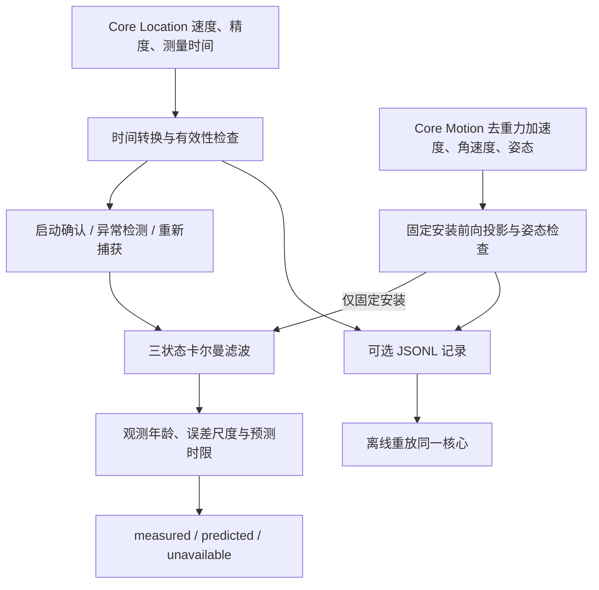

# 测速原理、算法与参数

本文描述 2026-10-17 的测速实现。2026-10-18 新增的独立出行状态识别见 [乘车与自主出行识别](travel-recognition.md)，不改变本页的测速噪声参数及安装条件。原理和参数以源码为准；实验方法见 [调参与实测手册](tuning.md)，使用入口见 [README](../README.md)。

## 1. 这个引擎究竟在估计什么

目标是电车、汽车、摩托车的地面移动速率，单位统一为 m/s，输出时可乘 3.6 转成 km/h。它是非负的速率，不包含倒车方向、位置、轨迹或航向。

系统分三层：先判断传感器输入能不能用，再估计速度及内部状态，最后判断估计结果是否还值得输出。一个数字平滑，并不说明它准确；长隧道里没有足够观测时，应结束估计。

当前安装到 iPhone 的默认入口是 `SpeedometerService()`，即**手持模式**。固定安装模式已实现，但需要修改初始化参数，明确提供安装前向轴；不会自动识别支架或交通工具。目前没有电车/汽车/摩托车三套已经实测调好的参数。

### 为什么不是 PID、滑动平均或位置差分

PID 用误差生成控制量；这里不控制车辆，而是根据有噪声的观测估计状态，所以使用状态估计。滑动平均能降低抖动，但窗口会让启动和制动滞后，也不能表达失联后的可信程度。

当前直接使用 `CLLocation.speed`，不自行从相邻经纬度差分计算速度。举例：一秒间隔内位置误差变化 5 米，简单距离差分就可能多出约 5 m/s 的量级。这个例子只解释误差传播，不能反推系统速度的真实误差。

文中的“GNSS”是定位速度通道的简称。App 读取的是 Core Location 输出，不假设它一定是某种裸卫星多普勒观测，也不假设系统内部的定位与运动数据完全独立。

## 2. 输入、坐标与时间

### 2.1 数据合同

| 输入 | 字段 | 单位与含义 |
|---|---|---|
| `SpeedObservation` | `timestamp` | 测量时刻，单调秒 |
| 同上 | `speed` | 系统速率，m/s |
| 同上 | `speedAccuracy` | 系统提供的速度精度值，m/s，用作权重参考 |
| 同上 | `horizontalAccuracy` | 水平位置精度，m，只做有效性门控 |
| `MotionObservation` | `timestamp` | 运动测量时刻，单调秒 |
| 同上 | `acceleration` | 已去重力、投影到车辆前向的加速度，m/s² |
| 同上 | `rotationRate` | 三轴角速度的模，rad/s；适配层姿态失败时传入拒绝用标记值 |
| 两类 ingest | `receivedAt` | 程序收到并处理事件的时刻，单调秒 |

`horizontalAccuracy` 不参与速度观测方差公式；代码也不使用经纬度、航向、道路或线路地图。记录里的原始三轴加速度和重力仍是 Core Motion 的 g 单位；只有投影后的 `motion.acceleration` 是 m/s²。

### 2.2 两个时刻不能混为一谈

Core Location 的日期经 `LocationClock` 转成与 uptime 一致的时间：首次记住 `offset = wallNow - monotonicNow`，随后计算 `fixTime = fixWallTime - offset`。若当前 offset 与已记住的值相差超过 1 秒，适配层丢弃本次观测并重置滤波器，时钟对象更新 offset 供后续回调使用。

位置批次在适配层按测量日期排序；核心仍独立拒绝重复和倒序测量。GPS 和运动各自维护最后输入时间，并要求处理时间不能落在滤波状态时间之前。最后有效输入时间与最后接受的速度观测时间是两个变量：一个坏速度即使进入异常检测，也不能更新“最近可信定位”的年龄。

核心不是固定采样间隔算法，预测使用真实 `Δt`。运动样本也在接收时刻融合；当前实现不做历史状态回滚或固定延迟平滑。

### 2.3 延迟定位的近似补偿

对延迟不超过 2 秒的有效位置观测，令：

\[
\ell=\max(0,t_{receive}-t_{fix}),\qquad \sigma_v=\max(0.35,\text{speedAccuracy})
\]

\[
z_v=\max(0,\text{speed}+a^-\ell),\qquad R_v=k\,\sigma_v^2+4\ell^2
\]

也就是按当前预测加速度，把过去的速度近似推到接收时刻，并增加方差。系数 4 相当于给这段延迟引入 2 m/s² 的加速度误差尺度。`k ≥ 1` 是第 4.3 节在线学到的噪声倍数。

曾试过“精确”的延迟观测 `H = [1, −ℓ, 0]`、`R = σ² + qℓ³/3`：多种子套件中巡航 RMSE 变差约 11%，精度被低报场景最大误差变差 77%，已放弃。原因是 `4ℓ²` 实际起到了有益的平滑作用。最终观测年龄仍从原始测量时刻计算，不因补偿变成“刚测到”。

这是工程近似：急刹或接收延迟变化很快时，当前加速度不一定代表延迟区间的平均加速度。它不是完整的异步观测重放。运动样本没有同样的延迟补偿，只接受年龄不超过 0.25 秒的输入。

## 3. 三状态模型

### 3.1 状态与初始化

\[
\mathbf{x}=\begin{bmatrix}v&a&b\end{bmatrix}^{T}
\]

- `v`：速率，m/s。
- `a`：车辆纵向加速度，m/s²。
- `b`：投影加速度的加性偏置，m/s²。

初始化使用确认链最后一次速度，`b = 0`。`a` 来自最后两个候选速度差分并限制到 ±12 m/s²；这里只用差分初始化加速度，不是用位置差分测速。初始速度也按上述延迟补偿。

\[
P_0=\operatorname{diag}(R_v,9,0.25)
\]

因此加速度初始标准差为 3 m/s²，偏置初始标准差为 0.5 m/s²。默认手持模式没有加速度观测，偏置不参与速度校正；保留三状态是为了共享同一实现。

### 3.2 预测：短时间内近似恒加速度

\[
F(\Delta t)=\begin{bmatrix}1&\Delta t&0\\0&1&0\\0&0&1\end{bmatrix}
\]

\[
\mathbf{x}^{-}=F\mathbf{x}^{+},\qquad P^{-}=FP^{+}F^{T}+Q
\]

`v ← v + a Δt`，加速度和偏置均允许随时间漂移。对加速度采用连续白噪声 jerk 模型，对偏置采用随机游走：

\[
Q=\begin{bmatrix}
q\Delta t^3/3&q\Delta t^2/2&0\\
q\Delta t^2/2&q\Delta t&0\\
0&0&q_b\Delta t
\end{bmatrix}
\]

这里 `q` 是加速度导数噪声的功率谱密度，单位 m²/s⁵；`q_b` 同为 m²/s⁵。不能把它们当成速度标准差，也不能把连续噪声参数直接当成每帧固定方差。

默认 `q = 0.2`，`q_b = 0.0004`。`q` 大表示更不相信“加速度维持不变”，响应更快，但更容易从速度噪声中估出虚假的加速度。

### 3.3 两类观测

位置速度：

\[
z_v=H_v\mathbf{x}+\epsilon_v,\qquad H_v=\begin{bmatrix}1&0&0\end{bmatrix}
\]

固定安装加速度：

\[
z_a=H_a\mathbf{x}+\epsilon_a,\qquad H_a=\begin{bmatrix}0&1&1\end{bmatrix},\qquad R_a=0.36
\]

因此加速度观测描述的是 `a + b`；`R_a` 对应 0.6 m/s² 的噪声标准差。只有 IMU 时，真实加速度和偏置无法凭这一项观测分开。定位速度随时间的变化提供额外约束，让滤波器逐渐区分 `a` 与 `b`。模型中的偏置只能描述这一路投影上的加性误差，不能自动修正错误安装方向、任意手持运动或完整三轴标定误差。

### 3.4 校正与数值处理

对任意一类标量观测：

\[
r=z-H\mathbf{x}^{-},\quad S=HP^{-}H^{T}+R,\quad K=P^{-}H^{T}/S
\]

\[
\mathbf{x}^{+}=\mathbf{x}^{-}+Kr
\]

协方差使用 Joseph 形式：

\[
P^{+}=(I-KH)P^{-}(I-KH)^{T}+KRK^{T}
\]

之后取 `P ← (P + Pᵀ)/2`，对角线至少为 `1e-9`。Joseph 形式降低数值问题的风险；对称化和正对角线本身不能证明任意情况下矩阵都正定。

预测与更新后还进行速率约束：内部 `v < 0` 时设为 0，并把负的 `a` 设为 0，避免持续刹车被积分成“反向速率”；`a` 限制在 ±12 m/s²。输出速度再限制在 0…140 m/s。这些是非线性截断，没有同步做严格的截断分布协方差修正，所以内部高斯模型是近似。

另有独立静止判定：系统活动来源可用且高置信度静止持续至少 3 秒（无 automotive、walking、running、cycling、unknown 冲突）；连续 IMU 安静至少 3 秒（去重力加速度模长 ≤0.08 g、角速度模长 ≤0.35 rad/s，样本间隔 ≤0.3 秒）；两次新鲜位置跨度至少 5 秒、水平精度 ≤25 米、距锚点 ≤6 米。初次确认要求上述安静窗口；确认后允许手部抖动和转动，不再把 IMU 安静作为维持零速的硬条件。维持期间仍要求系统高置信度静止、持续传感器数据及稳定位置。位置测量超过 20 秒、IMU 超过 0.3 秒，或出现活动冲突、可信移动速度、位置变化，立即撤销静止输出。中断后重新确认仍需安静窗口，不能复用旧静止状态。有可信速度 ≥0.8 m/s（精度 ≤2 m/s、水平精度 ≤50 米）时，至少 30 秒不允许静止覆盖。

确认后输出 speed=0、source=stationary、state=predicted；界面标为“静止”，不冒充 GNSS 实测，uncertainty=nil，不声称经统计标定的速度精度。仅手机安静、位置稳定或单个无效速度都不足以归零。无速度时继续显示未知，提示等待速度或静止证据。此判定是保守启发式，阈值仍需实际手持与乘车数据验证。

## 4. 定位异常与重新捕获

### 4.1 先检查输入合同

检查按下面次序执行，遇到第一项失败就返回：

| 条件 | 当前门限 | 返回值 |
|---|---|---|
| 接收/测量时间为有限数，未来时间不超容差 | `timestamp <= now + 0.05 s` | 失败为 `invalidTime` |
| 测量未过期 | `now - timestamp <= 2 s` | 失败为 `stale` |
| 速度有限且在范围内 | `0…140 m/s`，即最高 504 km/h | 失败为 `invalid` |
| 速度精度有限且有效 | `0…5 m/s` | 失败为 `invalid` |
| 水平精度有限且有效 | `0…100 m` | 失败为 `invalid` |
| 比上个已通过合同检查的定位更新 | 时间严格递增 | 失败为 `outOfOrder` |
| 接收时间不倒退到滤波状态之前 | `now >= state.time` | 失败为 `outOfOrder` |

精度为零会被接受，但用 0.35 m/s 的下限计算权重；负精度不会被补成默认值。上限和未来容差的边界包含在有效范围内。

### 4.2 启动确认

没有有效状态时，第一个定位只返回 `candidate`。第二个候选需满足：

\[
0.2\le\Delta t_{candidate}\le2.5\ \mathrm{s}
\]

\[
|v_{new}-v_{previous}|\le12\Delta t_{candidate}+1\quad(\mathrm{m/s})
\]

满足后建立状态，返回 `accepted`；否则从新候选重新计数。默认约 1 Hz 定位时，这通常需要两次回调，不是固定等待一秒。启动候选沿用输入合同的精度上限 5 m/s，并非都要求精度 ≤1 m/s。

### 4.3 正常跟踪的双门限

先与最后接受的原始速度比较：

\[
|v_{new}-v_{last}|\le12(t_{new}-t_{last})+3\sqrt{\sigma_{new}^{2}+\sigma_{last}^{2}}
\]

前项允许真实加减速，后项容纳两次速度精度的不确定性。例如前后速度精度都是 0.5 m/s，相隔一秒，允许变化约 `12 + 3√0.5 = 14.12 m/s`；从 20 跳到 80 m/s 会被拒绝。

物理门限通过，且初次创新同时超过 2.5 m/s 和 `2.5·√S`（`S` 为常规模型下的创新方差）时，从上一次实际滤波状态重新预测这一个区间，改用 `q = 4`。门限随预测离散度放大：定位越嘈杂，越需要更大的跳变才判定为机动，避免把抖动当成加减速去外推。之后计算：

\[
\mathrm{NIS}=r^2/S\le25
\]

物理门限和 NIS 都通过才更新滤波器。25 不应宣称为真实设备上已经校准的显著性门限。

**定位噪声倍数 `k`。** 每个未触发机动、被接受的定位，用常规模型的 NIS 更新

\[
k\leftarrow\mathrm{clamp}\big(k\,(1+0.1(\mathrm{NIS}-1)),\ 1,\ 6\big)
\]

接收机低报误差时 NIS 长期大于 1，`k` 上升，定位被降权；报告诚实时 `k` 停在 1 附近。机动段的残差反映的是过程模型而非接收机噪声，不参与更新。`k` 随状态重置清零，写入诊断字段 `gnssNoiseScale`，便于真机记录核对。

**试过但未采用。** 两模型 GPB1（按似然软混合 q=0.2 与 q=4）在所有转移概率设置下都不优于上述硬门限；"连续两次同号残差即判机动"也无收益；确认静止期间的零速更新（ZUPT，仅速度或速度+加速度，σ 0.05–0.2，并在离站时放大加速度方差）都让 stop-and-go 变差 2.5–7%。数据见 [tuning.md](tuning.md) 第 2.3 节。

高噪声预测只针对本次位置更新的预测区间，不会永久改默认 `q`。若 IMU 已将状态推进到同一接收时刻，重新预测的 `Δt` 会很小甚至为零，此时这个切换作用也很小。

### 4.4 连续异常与定位恢复

单点异常返回 `outlier`，不提交试算状态，也不刷新最后可信定位时间。

若异常速度的精度 ≤1 m/s，进入候选链；连续三个满足第 4.2 节相容条件的候选可以重建状态。它允许真实速度已经偏离旧模型时恢复，避免一直拒绝新数据。精度 >1 m/s 的异常会清空该候选链。重捕获不是证明新观测正确：连续一致的错误系统速度仍可能通过。

新位置到来时，如果距最后接受的**测量时间**已超过当前预测时限（普通 3 秒，可信惯性 6 秒），清空旧状态和候选，重新走两次启动确认；不会让旧状态因协方差变大而直接接纳一个大跳点。

`estimate(at:)` 本身不改变滤波状态。单纯因为误差尺度超过门限而输出不可用，也不立即删除内部状态；下一次位置输入依据观测年龄决定是否需要两次重新确认。

## 5. 固定安装惯性辅助

### 5.1 为什么自由手持不用加速度积分

手机自身拿动、换角度会混进加速度；传感器不能仅凭某一时刻的安静区分静止和匀速。默认手持模式对 `MotionObservation` 返回 `ignored`。适配层仍可采集原始运动数据用于记录，但不送入速率融合。

### 5.2 前向轴与单位转换

调用者提供设备坐标中的车辆前向向量 `d`。`MountAxis` 先归一化：长度必须有限且大于 `1e-6`。Core Motion 的 `userAcceleration` 已由系统去掉重力，适配层计算：

\[
z_a=9.80665\,\hat{d}^{T}\mathbf{u}_{device}
\]

例如手机顶端沿车辆前进方向，`MountAxis(x: 0, y: 1, z: 0)`，`u_y = -0.2 g`，则纵向加速度是 `-1.96133 m/s²`。前向轴方向取反会把加速和制动翻转；滤波器无法保证自动发现这个错误。

本实现使用 `.xArbitraryZVertical` 记录姿态，没有把加速度旋转到真北坐标系，没有依赖磁北、GPS course 或自动学习车辆前向轴。固定设备轴直接投影只在实际安装保持有效时成立。

### 5.3 先检查能否融合，再判断能否延长预测

运动输入先要求：有限时间；未来容差 0.05 秒；年龄不超过 0.25 秒；加速度有限且绝对值 ≤15 m/s²；角速度有限且非负；测量时间严格递增。

角速度 >0.25 rad/s 会锁定禁用惯性。适配层还检查相对初始四元数：

\[
c=|q_0^Tq|,\qquad c<\cos(5^\circ)\Rightarrow\text{相对旋转角超过 }10^\circ
\]

四元数长度须满足 `|norm(q)-1| < 0.01`，先归一化再比较；绝对内积让 `q` 与 `-q` 表示同一姿态。姿态失败后，适配层保留原始角速度记录，但给投影观测的 `rotationRate` 写入标记值 1 rad/s，触发核心锁定。因此投影观测的这个字段在失败时不是实际角速度。

锁定后设置 `motionBlockedUntil = infinity`，清除惯性连续计时和最近 IMU 标记，重置偏置为 0、偏置方差为 0.25，并重置加速度为 0、加速度方差至少为 9，去掉偏置与另外两状态的交叉协方差。定位测速仍可继续。应重新确认安装，再 `stop()`/`start()`；只重复调用已启动服务的 `start()` 不会重置。服务重新开始时也会重置姿态基准。

角速度正常且已有滤波器、最近位置年龄 ≤6 秒、接收时间不倒退时，就可以融合加速度。**8 秒等待只控制是否允许把预测时限延长到 6 秒，不是融合前完全不使用 IMU。**

延长预测需同时满足：

| 条件 | 当前门限 |
|---|---|
| 明确固定安装模式 | `.mounted` |
| 最近接受的 IMU 足够新 | `now - lastMotion <= 0.25 s` |
| 有连续采样跨度 | `lastMotion - motionStart >= 8 s` |
| 偏置估计足够收敛 | `sqrt(P_bb) <= 0.3 m/s²` |
| 未被姿态/旋转锁定 | `now >= motionBlockedUntil` |

运动输入相邻测量间隔 >0.3 秒，会重启连续采样计时；这个分支不会单独清空已学偏置。8 秒是时间跨度，不是样本个数保证；0.3 m/s² 是模型内部收敛门限，不代表真实偏置已被独立标定。

车辆转弯、倾斜也可能触发禁用。当前没有道路几何或航向融合来区分车辆转弯与手机拿动，因而选择保守退回定位模式。

## 6. 输出状态、隧道与误差尺度

令 `τ = max(0, now - lastAcceptedFix.timestamp)`。`estimate(at:)` 复制内部状态做预测，查询次数、显示刷新率不会推进实际滤波器。

| 条件 | state | source | speed |
|---|---|---|---|
| 有有效状态、`τ <= 1 s` 且未触发失效 | `measured` | `location` | 融合估计值 |
| `τ > 1 s`，普通预测仍有效 | `predicted` | `model` | 融合预测值 |
| `τ > 1 s`，惯性可信且预测仍有效 | `predicted` | `inertial` | 融合预测值 |
| 未确认、超过时限、误差过大、无效查询等 | `unavailable` | `none` | `nil` |

`measured` 表示有一秒以内的新鲜已接受定位，不是未经滤波的原始读数；即使刚融合过 IMU，这个时间段的 source 仍标为 `location`。`source` 是通道/年龄标签，不是对当前误差的独立保证。

误差尺度使用协方差与额外增长下限两者中较大值：

\[
\sigma_0=\max(0.35,\text{lastFix.speedAccuracy})
\]

\[
g_{model}(\tau)=0.75\tau^2
\]

\[
g_{imu}(\tau)=\sqrt{(0.35\tau)^2+(0.12\tau^2)^2}
\]

\[
c\leftarrow c+0.1\,(\text{NIS}-c)
\]

\[
s=\min\left(3,\max\left(1,\sqrt{c}\right)\right)
\]

\[
u=s\cdot\max\left(\sqrt{P_{vv}^{pred}},\sqrt{\sigma_0^2+g(\tau)^2}\right)
\]

`c` 是所有已接受定位（含机动段）NIS 的指数平均，初值 1，随状态重置。NIS 长期大于 1 说明滤波器自估的散布偏小——例如接收机低报精度且超出噪声倍数 `k` 的修正能力，或机动频繁——此时按 `√c` 放宽输出误差尺度，诊断字段 `uncertaintyScale` 记录该倍数。它只放宽、不收窄：相关误差（多路径、系统定位内部平滑）会让相邻定位彼此相似而压低 NIS，小 NIS 不能证明估计比模型更准。`s` 只作用于输出 `u`，不改变状态、增益或超时判断以外的任何量；`u > 8` 的截止按放宽后的值计算。

`u > 8 m/s` 或非有限时结束输出。普通预测超过 3 秒结束；惯性可信时超过 6 秒结束；边界时刻本身仍可能有效。IMU 一旦不够新，时限即时回到 3 秒，不能因为之前曾可信就维持 6 秒。

例如最后速度精度 0.5 m/s，纯模型在 2 秒的额外增长是 3 m/s，合成下限约 3.04 m/s；到 3 秒约 6.77 m/s。惯性在 4 秒的增长约 2.38 m/s，合成下限约 2.43 m/s。实际输出还可能被 `sqrt(P_vv)` 或一致性倍数 `s` 抬高。

这些数值表达“时间越久越不可靠”的工程策略。合成套件中常规场景的 1σ 覆盖约 0.80–0.96（偏保守），低报精度与相关误差场景约 0.56–0.63（偏乐观），见 [tuning.md §2.3](tuning.md)。`u` 未经真机校准为 1σ、95% 或任何确定覆盖率，也不能解释为“真实误差必然小于 u”。IMU 各帧相关性、系统定位内部传感器融合、错误安装方向，以及状态截断都会让理想统计假设偏离现实。

速度不可用时 `uncertainty` 也为 nil；`observationAge` 在已知最后定位的超时情况下保留，在没有可用状态或查询时间无效等分支可以为 nil。非有限查询时间返回的 timestamp 为 0，消费者应先看 state。

## 7. 参数索引与修改位置

目前参数是源码常量，没有运行时配置文件或命令行覆盖。调参要修改对应源码并重新构建；同一数值用于不同目的时要分别审查。

| 参数组 | 当前值 | 位置 |
|---|---|---|
| 常规/机动 jerk PSD；偏置随机游走 PSD | `0.2 / 4 / 0.0004 m²/s⁵` | `KalmanState.cruiseJerk / maneuverJerk`；偏置在 `KalmanState.predict` |
| 初始加速度/偏置方差 | `9 / 0.25 (m/s²)²` | `KalmanState.init`；禁用惯性时也恢复相关值 |
| 速度精度下限、延迟方差系数 | `0.35 m/s`；`4 (m/s²)²` | `SpeedEstimator` 的位置更新、capture、estimate 等多处 |
| IMU 观测方差 | `0.36 (m/s²)²` | `SpeedEstimator.ingest(motion:)` |
| 速度/速度精度/水平精度范围 | `0…140 m/s`；`0…5 m/s`；`0…100 m` | 位置输入合同；输出速度另有上限截断 |
| 未来容差；位置/运动最大年龄 | `0.05 s`；`2 s / 0.25 s` | 两类 ingest |
| 物理加速度上限、精度余量系数 | `12 m/s²`；`3` | 位置物理门限；12 也在 capture 和状态截断 |
| 机动触发；NIS 上限 | `max(2.5 m/s, 2.5√S)`；`25` | `Tuning`（SpeedEstimator.swift）；位置 ingest |
| 定位噪声倍数学习率、上限 | `0.1 / 6` | `Tuning` |
| 输出一致性倍数学习率、上限 | `0.1 / 3`，只放宽 | `Tuning` |
| 启动/异常重捕获候选数 | `2 / 3` | 位置 ingest 与 capture |
| 候选间隔、速度余量 | `0.2…2.5 s`；`1 m/s` | capture |
| 异常候选精度上限 | `1 m/s` | 位置 ingest |
| 运动加速度/角速度上限 | `15 m/s² / 0.25 rad/s` | 运动 ingest |
| 连续运动间隔、预热、偏置门限 | `0.3 s / 8 s / 0.3 m/s²` | 运动 ingest、motionTrusted |
| 四元数模长容差、安装姿态门限 | `<0.01 / 5°` | `MountMonitor.accepts` |
| 轴最小长度、g 换算 | `>1e-6 / 9.80665 m/s²` | `MountAxis` |
| 输出新鲜度、普通/惯性预测时限 | `1 s / 3 s / 6 s` | estimate；位置 ingest 的超时重捕获也使用 3/6 |
| 误差增长系数与截止值 | 普通 `0.75 m/s³`；惯性 `0.35 m/s² / 0.12 m/s³`；截止 `8 m/s` | estimate |
| 协方差对角线数值下限 | `1e-9`，各状态对应方差单位 | `KalmanState.constrain` |
| 墙上时钟 offset 跳变门限 | `1 s` | `LocationClock.convert` |
| 请求运动频率、结果 tick | `20 Hz / 0.2 s`（约 5 Hz） | `SpeedometerService.begin` |
| 定位请求 | BestForNavigation、无距离过滤、otherNavigation、不自动暂停 | `SpeedometerService.init` |

上述值除单位换算、数据有效性语义外，主要是工程初值及合成场景选择，不是经过大量道路样本得出的最优参数。定位更新频率由系统决定，App 没有请求固定 1 Hz；1 Hz 是目前合成基准的设定。

## 8. iOS 运行与代码导航

服务在主 actor 上串行接收和输出。需要定位授权与 fullAccuracy，临时定位失败不刷新速度年龄。2026-10-19 起接入后台定位：进入后台或锁屏不主动停止定位、运动和 tick，也不 reset；返回前台延续当前滤波器与记录。模型由 AppDelegate 持有，Scene 断开重连不主动销毁采集服务。系统终止/手动划掉仍会中断运行，需以日志实际采样间隔核验连续性。

| 文件 | 责任 |
|---|---|
| [SpeedEstimator.swift](../Sources/SpeedCore/SpeedEstimator.swift) | 输入门控、模式、候选链、异常检测、输出失效 |
| [KalmanState.swift](../Sources/SpeedCore/KalmanState.swift) | F/Q、标量更新、Joseph 形式与状态截断 |
| [SensorBoundary.swift](../Sources/SpeedCore/SensorBoundary.swift) | 固定轴投影、时钟桥接、姿态锁定 |
| [Models.swift](../Sources/SpeedCore/Models.swift) | 输入、输出和枚举合同 |
| [Replay.swift](../Sources/SpeedCore/Replay.swift) | JSONL 事件模型与回放顺序 |
| [SpeedometerService.swift](../iOS/Speedometer/SpeedometerService.swift) | 真机传感器、生命周期、授权、记录 |
| [AppDelegate.swift](../iOS/Speedometer/AppDelegate.swift) | 无业务界面入口、默认手持模式、记录开关 |
| [Benchmark.swift](../Sources/SpeedReplay/Benchmark.swift) | 合成真值、噪声和统计口径 |

API 对照入口：[CLLocation.speed](https://developer.apple.com/documentation/corelocation/cllocation/speed)、[speedAccuracy](https://developer.apple.com/documentation/corelocation/cllocation/speedaccuracy)、[CMDeviceMotion.userAcceleration](https://developer.apple.com/documentation/coremotion/cmdevicemotion/useracceleration)。本实现的有效值、单位换算和实际判断仍应与上述源码及使用的 SDK 头文件一起核对。
